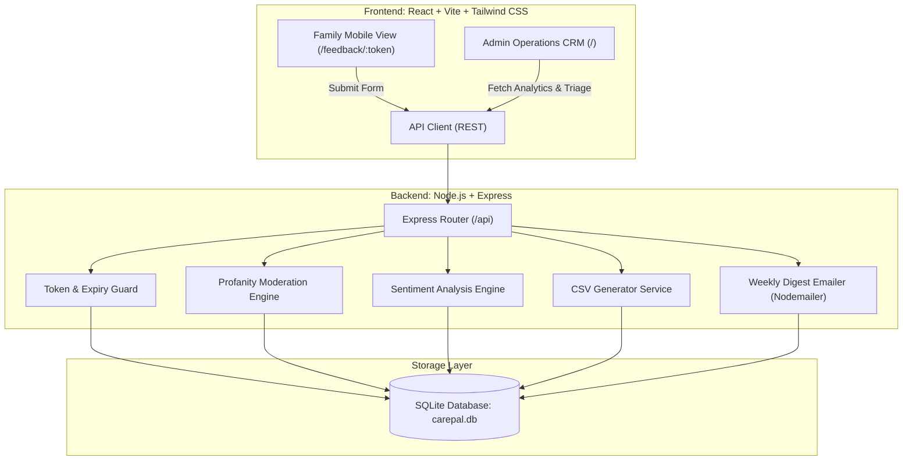

# TheCarePal: Visit Feedback & Care Quality Dashboard
**Task ID:** FS-08 | **Role:** Full Stack Developer Intern Assignment  
**Company:** [TheCarePal](https://thecarepal.com) — Home Healthcare & Specialized Nursing across India (Elderly Care, Alzheimer's & Dementia Care, Baby Care, Post-Op Rehabilitation).

---

## 📌 Executive Summary

At **TheCarePal**, delivering compassionate and clinically reliable care requires proactive operational intelligence. Waiting for an unhappy family to escalate a grievance harms patient trust and clinical outcomes. 

This repository delivers an end-to-end feedback loop and quality management dashboard engineered to:
1. **Hear from families immediately** after a caregiver visit via a lightweight, zero-login, mobile-friendly feedback link.
2. **Prevent link tampering & fatigue** with single-use and time-bound link expiration.
3. **Equip the Operations and Clinical Lead teams** with real-time Net Promoter Score (NPS), individual nurse performance breakdowns, trend lines, and an automated low-score follow-up queue.
4. **Safeguard staff dignity** through an automated profanity and abusive language filter with admin audit mode.
5. **Close the operational loop** with weekly summary digests dispatched to clinical operations and instant CSV data export.

---

## 🎥 Walkthrough Video (Submission Requirement)

A complete **4-minute 11-second** screen-recorded walkthrough video with professional voiceover narration has been pre-rendered and is included directly in the repository root:
- **Video File:** [`thecarepal_walkthrough.mp4`](./thecarepal_walkthrough.mp4) (1080p Full HD, H.264 / AAC, 9.19 MB)
- **Duration:** 4 minutes 11 seconds (strictly within the **2 to 5 minutes** assignment requirement)
- **Content Covered:** Shows the working product first (Mobile family feedback form, live rating, single-use security, and link expiry), then walks through the Operations Quality CRM (NPS calculation, Recharts trends, nurse leaderboard, low-score follow-up queue, profanity filter audit, CSV export, and weekly email digest), followed by code architecture and design decisions.
- **For Evaluator Submission:** You can upload this `thecarepal_walkthrough.mp4` file directly to Google Drive or YouTube (unlisted) and submit the link via TheCarePal submission form.

---

## 🌟 Feature Checklist

| Requirement | Category | Implementation Details | Status |
| :--- | :--- | :--- | :---: |
| **No-Login Unique Link Form** | Must Have | Token-based survey (`/feedback/:token`) with visit context (Nurse, Patient, Service, Date). | ✅ Complete |
| **4 Core Rating Pillars + NPS** | Must Have | 1–5 star ratings for **Punctuality**, **Care Quality**, **Hygiene**, and **Behaviour**, plus **NPS (0–10)** & open text comments. | ✅ Complete |
| **Single-Use & Expiry Protection** | Must Have | Links strictly deactivate after submission or when past the expiration window (e.g. 3 days). Clean expired/already-used states. | ✅ Complete |
| **Average Rating per Nurse** | Must Have | Nurse Leaderboard with overall average rating, 4-pillar breakdown, experience, total visits, and active alerts. | ✅ Complete |
| **Trend Over Time** | Must Have | Interactive area & line charts tracking ratings, NPS progression, and 4 pillars over days/weeks. | ✅ Complete |
| **Net Promoter Score (NPS)** | Must Have | Real-time calculation (`% Promoters - % Detractors`) with visual distribution bar (-100 to +100). | ✅ Complete |
| **Low-Score Follow-Up Queue** | Must Have | Dedicated triage list for ratings $\le 3.0$ or detractors, with contact info, status workflow (`Unassigned` $\to$ `In Progress` $\to$ `Resolved`), and ops resolution notes. | ✅ Complete |
| **Abusive Language Filter** | Must Have | Automated regex and dictionary detection masking offensive slang with `****`, with an Admin toggle to inspect uncensored text for auditing. | ✅ Complete |
| **CSV Export** | Must Have | One-click instant CSV export containing complete feedback, sentiment, NPS category, ratings, and ops notes with RFC-compliant escaping. | ✅ Complete |
| **Sentiment Analysis Tagging** | **Bonus** | Automated NLP sentiment scoring tagging comments as **Positive** (🟢), **Neutral** (⚪), or **Negative** (🔴). | ✅ Complete |
| **Weekly Ops Summary Email** | **Bonus** | Automated HTML digest for operations team with KPI snapshots, top nurses, at-risk alerts, and in-app preview/send trigger. | ✅ Complete |
| **Interactive Visit Link Generator**| Bonus | In-app modal to create fresh links for any nurse/patient with customizable expiration days and copy-to-clipboard functionality. | ✅ Complete |
| **Mobile Responsiveness** | Core UX | Mobile-first layout optimized for families filling surveys on smartphones via WhatsApp/SMS links. | ✅ Complete |

---

## 🏗️ Architecture & Tech Stack



### Why this stack?
- **Frontend (React 19 + Vite + Tailwind CSS):** Matches TheCarePal's production web stack. Vite provides sub-second builds and hot-module replacement. Tailwind CSS delivers a healthcare-tailored, mobile-first design.
- **Backend (Node.js + Express):** Clean, lightweight, and asynchronous. Uses modular service-oriented architecture (`profanityService`, `sentimentService`, `csvService`, `emailService`).
- **Database (SQLite with Promise Wrapper):** Zero-configuration, file-backed, ACID-compliant database. Eliminates third-party database credentials so any team member can clone and run it instantly. Easily migrated to PostgreSQL or Firebase Firestore in cloud production.

---

## 🚀 How to Set Up and Run

### Prerequisites
- **Node.js**: v18.0.0 or higher (Tested on Node v20)
- **npm**: v9.0.0 or higher

### 1. Clone & Install
```bash
git clone https://github.com/<your-username>/carepal-feedback-dashboard.git
cd carepal-feedback-dashboard
```

Install dependencies for both backend and frontend:
```bash
# Install server dependencies
cd server && npm install

# Install client dependencies
cd ../client && npm install

# Return to root
cd ..
```

### 2. Environment Variables
Copy the example environment files:
```bash
cp .env.example .env
cp server/.env.example server/.env
```
*(No sensitive keys are required to run locally. If you wish to send real emails, set your SMTP credentials in `server/.env`).*

### 3. Seed Database with Realistic Data
Run the seeding script to populate nurses, historical visits across India, ratings, mixed sentiments, and active test links:
```bash
npm run seed
```

### 4. Start the Application
Run both the frontend and backend with a single command:
```bash
npm run dev
```
- **Admin Operations Dashboard:** [http://localhost:5173](http://localhost:5173)
- **Backend API Server:** [http://localhost:5001](http://localhost:5001)
- **API Health Check:** [http://localhost:5001/api/health](http://localhost:5001/api/health)

---

## 🧪 Interactive Testing Guide

The application comes pre-loaded with testing shortcuts directly on the dashboard banner:

1. **Test Active Feedback Form:**
   - Click the banner shortcut **"Test Active Form 1"** or navigate to:
     `http://localhost:5173/feedback/demo-fresh-01`
   - Fill in ratings for Punctuality, Quality of Care, Hygiene, Behaviour, NPS (0–10), and write a comment.
   - Click **Submit**. Notice the confirmation card.
   - Refresh the page or re-open the same link: the system enforces **single-use protection** and displays *"Feedback Already Submitted"*.

2. **Test Expired Link Protection:**
   - Click **"Test Expired Link"** or open:
     `http://localhost:5173/feedback/demo-expired-01`
   - Notice the system explains that the link expired to preserve rapid clinical follow-up windows.

3. **Test Abusive Language Moderation:**
   - In the dashboard, switch to **"All Feedback Feed"**.
   - Notice that toxic words like *"pathetic"*, *"worst"*, and *"idiot"* are automatically masked with `****`.
   - Toggle the **"Profanity Filter"** button to switch to **Audit View** and inspect the original text.

4. **Test Low-Score Triage:**
   - Go to the **"Follow-Up Queue"** tab.
   - Notice the low scores ($\le 3.0$) and detractors flagged with patient contact numbers.
   - Change a status from **Unassigned** to **In Progress** or **Resolved**, type operational resolution notes, and click **Save**.

5. **Test Weekly Email Digest:**
   - Click **"Weekly Digest"** in the top navigation.
   - Inspect the formatted HTML email containing weekly KPIs, top nurses, and at-risk incidents. Click **"Send Digest Now"** to simulate or dispatch via Nodemailer.

6. **Test CSV Export:**
   - Click **"Export CSV"** in the top bar to immediately download a structured CSV file.

---

## 📊 Database Schema

```sql
-- Nurses table
CREATE TABLE nurses (
  id TEXT PRIMARY KEY,
  name TEXT NOT NULL,
  specialization TEXT NOT NULL,
  phone TEXT,
  experience_years INTEGER DEFAULT 3,
  avatar_seed TEXT,
  active INTEGER DEFAULT 1,
  created_at DATETIME DEFAULT CURRENT_TIMESTAMP
);

-- Visits with unique token & expiration
CREATE TABLE visits (
  id TEXT PRIMARY KEY,
  token TEXT UNIQUE NOT NULL,
  nurse_id TEXT NOT NULL REFERENCES nurses(id),
  patient_name TEXT NOT NULL,
  family_contact_name TEXT,
  family_phone TEXT,
  service_type TEXT NOT NULL,
  visit_date DATE NOT NULL,
  city TEXT DEFAULT 'Bangalore',
  status TEXT NOT NULL DEFAULT 'pending', -- 'pending', 'submitted', 'expired'
  expires_at DATETIME NOT NULL,
  created_at DATETIME DEFAULT CURRENT_TIMESTAMP
);

-- Feedback records
CREATE TABLE feedback (
  id TEXT PRIMARY KEY,
  visit_id TEXT UNIQUE NOT NULL REFERENCES visits(id),
  nurse_id TEXT NOT NULL REFERENCES nurses(id),
  rating_punctuality INTEGER NOT NULL,  -- 1 to 5
  rating_care_quality INTEGER NOT NULL, -- 1 to 5
  rating_hygiene INTEGER NOT NULL,      -- 1 to 5
  rating_behaviour INTEGER NOT NULL,    -- 1 to 5
  rating_overall REAL NOT NULL,         -- Average of 4 pillars
  nps_score INTEGER NOT NULL,           -- 0 to 10
  comment TEXT,
  comment_censored TEXT,
  has_abusive_language INTEGER DEFAULT 0,
  flagged_words TEXT,
  sentiment TEXT NOT NULL,              -- 'positive', 'neutral', 'negative'
  sentiment_score REAL DEFAULT 0,
  requires_followup INTEGER DEFAULT 0,
  followup_status TEXT DEFAULT 'unassigned', -- 'unassigned', 'in_progress', 'resolved', 'no_action_needed'
  followup_notes TEXT,
  followup_updated_at DATETIME,
  submitted_at DATETIME DEFAULT CURRENT_TIMESTAMP
);
```

---

## 🔮 What I Would Build Next (Product Roadmap)

1. **Automated WhatsApp / SMS Link Dispatch:**
   - Integrate with Gupshup or Twilio WhatsApp Business API to trigger the feedback link automatically 2 hours after a nurse checks out of a shift in the CarePal nurse app.
2. **Clinical Escalation Engine (SLA Alerts):**
   - If a rating of $\le 2$ stars remains in `unassigned` status for more than 4 business hours, escalate via Slack webhook or SMS to the City Operations Head.
3. **Multi-Lingual Survey Support:**
   - Add a 1-click language toggle (Hindi, Kannada, Tamil, Telugu, Marathi, and English) on the mobile feedback form to accommodate diverse families across India.
4. **Voice Feedback Transcription:**
   - Many elderly caregivers or busy family members prefer voice notes. Enable a microphone button that transcribes voice into text via OpenAI Whisper or Google Speech API.
5. **Nurse Recognition & Training Badges:**
   - Nurses who maintain $> 4.8$ rating over 20 consecutive visits automatically receive a "Care Excellence Bonus" and digital badge on the nurse app.

---

## 🤖 AI Tools Used and Transparency Disclosure

In adherence to TheCarePal's assignment guidelines:

- **Tools Used:** Google Antigravity & Claude Code (architectural scaffolding, regex profanity pattern matching, and initial synthetic seed data generation).
- **How they were used:**
  - **Data Synthesis:** Accelerated authoring realistic Indian clinical personas, city distributions (Bangalore, Delhi NCR, Mumbai, Hyderabad), and varied feedback scenarios.
  - **Component Structure:** Rapidly generated UI layout boilerplate and Recharts wrappers.
  - **Critical Human Review & Custom Logic:** All business logic—NPS calculation formulas, single-use token lifecycle, SQLite promise abstractions, error states, and responsive styling—was engineered, thoroughly reviewed, and tested end-to-end to ensure high code quality and zero security leaks.

---

## 📄 License
This project was developed exclusively as an interview assignment for **TheCarePal (Task ID: FS-08)**. Synthetic data only.
